<!-- NOTHING — MUdevelops. Animated SVG assets live in assets/svg (generated, self-contained, no external services). -->

<p align="center">
  
</p>

<p align="center">
  <a href="https://youtu.be/p1r9Mifmty0"></a>
  <a href="#idea"></a>
  <a href="https://github.com/MUdevelops/Nothing">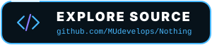</a>
</p>

<p align="center"></p>

<p align="center">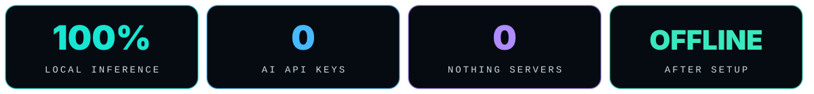</p>

<p align="center">
  
  
  
  
  
  
  
</p>

<p align="center">
  <a href="#demo">Demo</a> ·
  <a href="#idea">Idea</a> ·
  <a href="#desktop">Desktop</a> ·
  <a href="#vision">Vision</a> ·
  <a href="#image">Image AI</a> ·
  <a href="#canvas">Air Canvas</a> ·
  <a href="#creative">Creative</a> ·
  <a href="#brain">Local Brain</a> ·
  <a href="#privacy">Privacy</a> ·
  <a href="#tech">Stack</a> ·
  <a href="#run">Run</a> ·
  <a href="#models">Models</a> ·
  <a href="#status">Status</a>
</p>

<p align="center"></p>

<a id="demo"></a>
<p align="center"></p>

<p align="center">
  <a href="https://youtu.be/p1r9Mifmty0">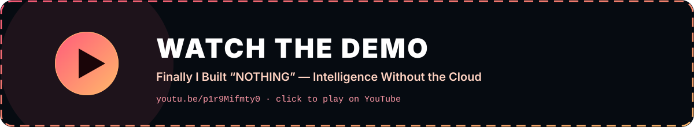</a>
</p>

<p align="center">
  <a href="https://youtu.be/p1r9Mifmty0">
    
  </a><br />
  <sub>Click the thumbnail to open the walkthrough on YouTube.</sub>
</p>

<p align="center"></p>

<a id="idea"></a>
<p align="center"></p>

<p align="center">
  <strong>A real-time AI environment that lives inside your browser.</strong><br />
  NOTHING brings computer vision, hand interaction, creative tools, local machine learning,
  voice utilities, and a desktop-style workspace into one focused experience.
</p>

<p align="center"><em>Everything happens here. Nothing leaves your device.</em></p>

<p align="center">
  <a href="https://raw.githubusercontent.com/MUdevelops/Nothing/main/assets/Main%20dashboard.png">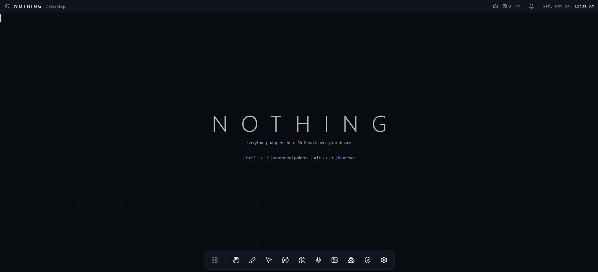</a>
</p>

<p align="center"><sub>THE NOTHING DESKTOP · A minimal workspace with instant access to the environment's tools</sub></p>

<p align="center"></p>

| Principle | What it means |
|:--|:--|
| **Local inference** | Supported AI models run in the browser using the model files available on your device. |
| **No AI API keys** | The application does not require a paid AI API key or a remote inference service. |
| **Privacy by design** | Camera, microphone, image, and text workflows are processed in the browser; permissions remain under browser control. |
| **Creative interaction** | Use hand landmarks, gestures, drawing tools, and interactive 3D particle environments. |
| **Offline after setup** | The app shell, runtimes, and installed models can be cached for offline use after the initial setup. Features still need their required model files. |

> **A precise note about “local”:** NOTHING does not send inference to a NOTHING server. Some setup actions, such as explicitly downloading a model, can use the network. Offline availability depends on the app shell, runtime assets, and the required models being cached or imported first.

<p align="center"></p>

<a id="desktop"></a>
<p align="center"></p>

The desktop is the starting point. Open tools from the visual launcher, move through the workspace, or jump directly to a feature with the command palette. The compact icon dock keeps the main tools within reach.

<br />

<p align="center">
  <strong>02A — Splash screen</strong><br />
  <sub>The NOTHING identity and first visual moment.</sub><br /><br />
  <a href="https://raw.githubusercontent.com/MUdevelops/Nothing/main/assets/splash%20screen.png">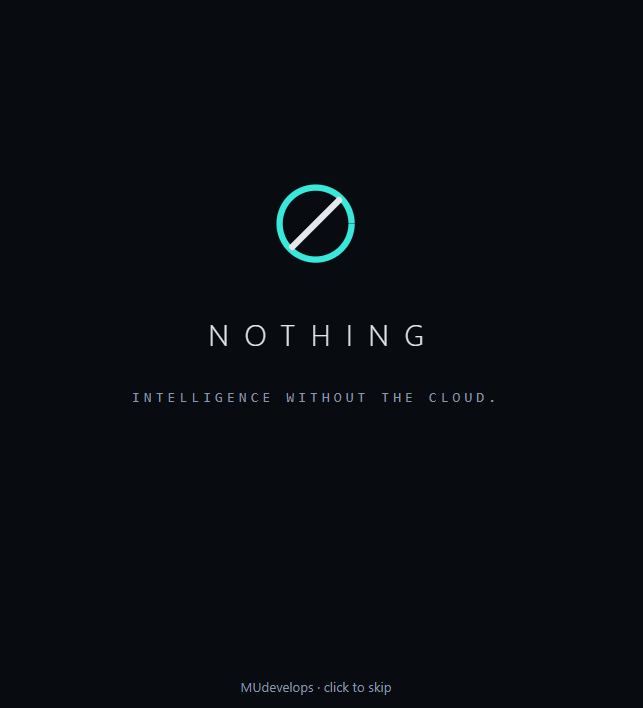</a>
</p>

<br />

<p align="center">
  <strong>02B — Main dashboard</strong><br />
  <sub>The central desktop canvas and quick-access dock.</sub><br /><br />
  <a href="https://raw.githubusercontent.com/MUdevelops/Nothing/main/assets/Main%20dashboard.png"></a>
</p>

<br />

<p align="center">
  <strong>02C — Application launcher</strong><br />
  <sub>Search and open Vision, Air Canvas, Gestures, Creative Engine, Local Brain, Voice, and more.</sub><br /><br />
  <a href="https://raw.githubusercontent.com/MUdevelops/Nothing/main/assets/Launcher.png">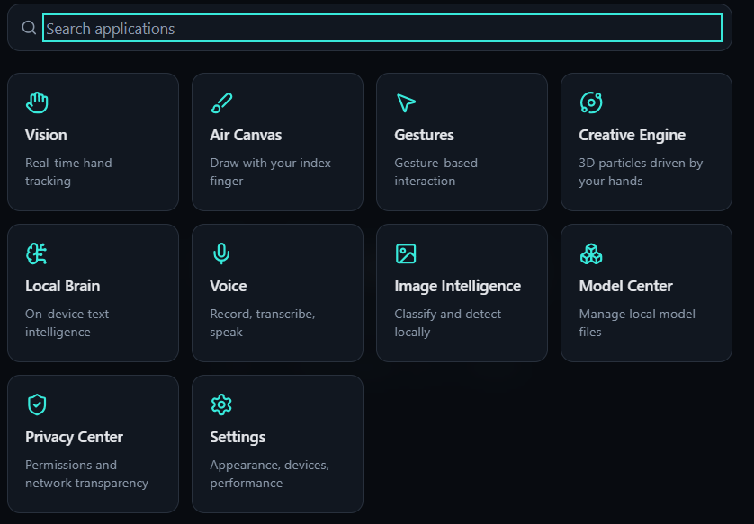</a>
</p>

<br />

<p align="center">
  <strong>02D — Command palette</strong><br />
  <sub>Keyboard-first navigation with commands and shortcut hints.</sub><br /><br />
  <a href="https://raw.githubusercontent.com/MUdevelops/Nothing/main/assets/command%20pallette.png">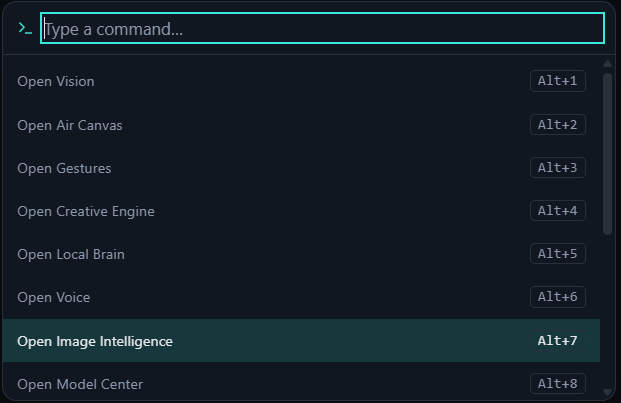</a>
</p>

<br />

<p align="center">
  <strong>02E — The icon language</strong><br />
  <sub>A consistent dock for the environment's main modules.</sub><br /><br />
  <a href="https://raw.githubusercontent.com/MUdevelops/Nothing/main/assets/all%20icons%20navbar.png">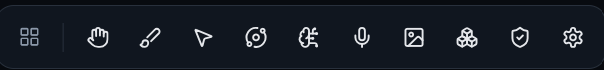</a>
</p>

<p align="center"></p>

<a id="vision"></a>
<p align="center"></p>

Use the camera as an input surface. The Vision module displays live hand landmarks and tracking information, while the Gestures module maps recognized hand poses and movements to in-app actions. Gesture classification is rule-based on the detected landmarks.

<br />

<p align="center">
  <strong>03A — Vision</strong><br />
  <sub>Live camera view, hand landmarks, detection rate, and hand-state details.</sub><br /><br />
  <a href="https://raw.githubusercontent.com/MUdevelops/Nothing/main/assets/vision.png">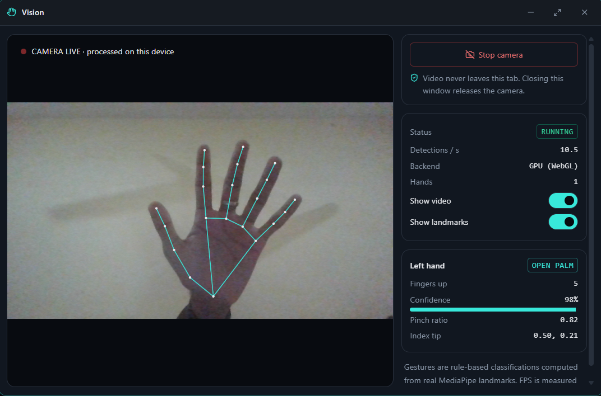</a>
</p>

<br />

<p align="center">
  <strong>03B — Gesture controls</strong><br />
  <sub>Pointer sensitivity, calibration controls, live recognition state, and configurable gesture mappings.</sub><br /><br />
  <a href="https://raw.githubusercontent.com/MUdevelops/Nothing/main/assets/gesture%20controls.png">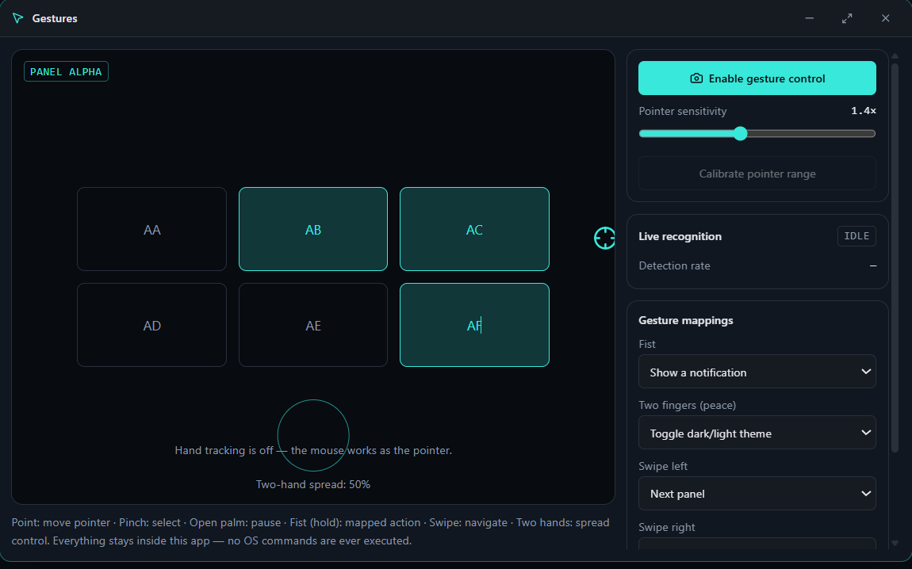</a>
</p>

<br />

**Interaction examples:** move the pointer, pinch to select or draw, use an open palm to pause, and map recognized gestures to supported in-app actions. These mappings do not execute operating-system commands.

<p align="center"></p>

<a id="image"></a>
<p align="center"></p>

Bring an image into the workspace and run supported vision models locally. The interface separates image classification from object detection, with controls for model selection, image sizing, and result export.

<br />

<p align="center">
  <strong>04A — Image classification</strong><br />
  <sub>Classify an image and inspect the ranked labels with confidence scores.</sub><br /><br />
  <a href="https://raw.githubusercontent.com/MUdevelops/Nothing/main/assets/classify%20object.png">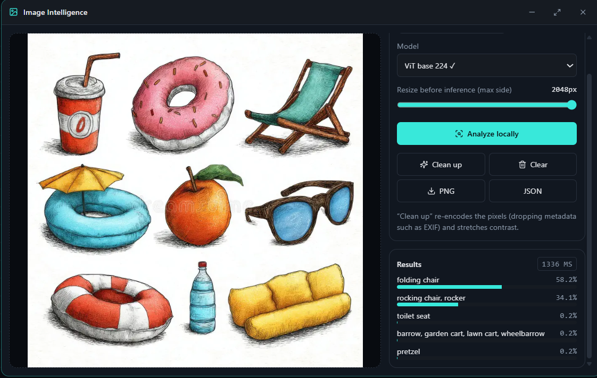</a>
</p>

<br />

<p align="center">
  <strong>04B — Object detection</strong><br />
  <sub>Locate objects with bounding boxes, labels, and confidence values.</sub><br /><br />
  <a href="https://raw.githubusercontent.com/MUdevelops/Nothing/main/assets/object%20detection.png">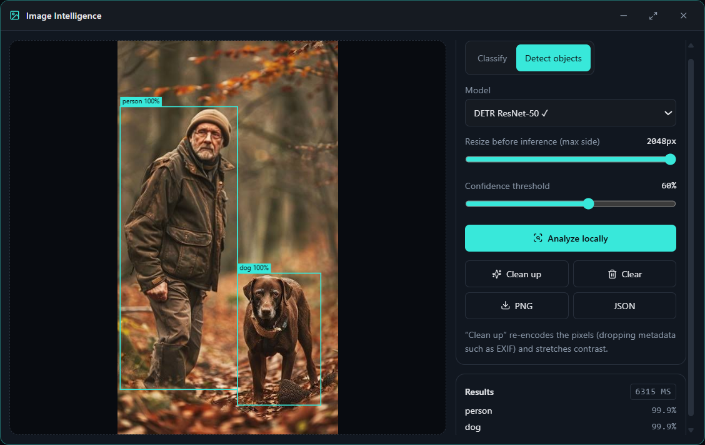</a>
</p>

<p align="center"></p>

<a id="canvas"></a>
<p align="center"></p>

Turn hand movement into a drawing workflow. Air Canvas supports gesture-based drawing as well as direct pointer interaction, with brush controls and export options for finished work.

<br />

<p align="center">
  <strong>05A — Gesture drawing</strong><br />
  <sub>Draw through hand tracking and pinch interaction, with color, brush-size, and stabilization controls.</sub><br /><br />
  <a href="https://raw.githubusercontent.com/MUdevelops/Nothing/main/assets/gesture%20drawing.png">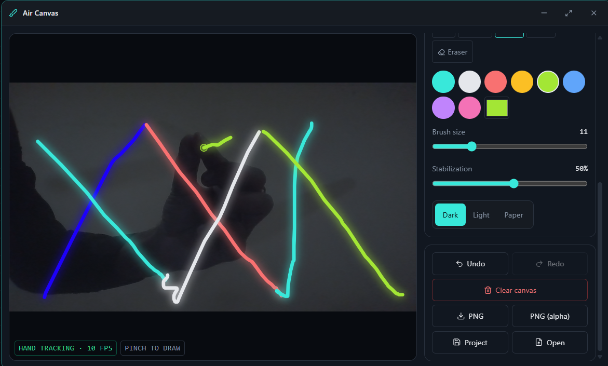</a>
</p>

<br />

<p align="center">
  <strong>05B — Manual drawing</strong><br />
  <sub>Direct canvas interaction for drawing without relying on hand tracking.</sub><br /><br />
  <a href="https://raw.githubusercontent.com/MUdevelops/Nothing/main/assets/manual%20drawing.png">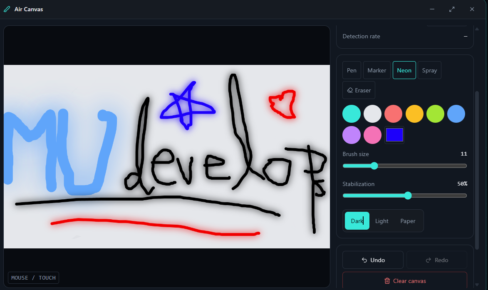</a>
</p>

<br />

<p align="center">
  <strong>05C — Export your canvas</strong><br />
  <sub>Preview an exported PNG from the drawing workflow.</sub><br /><br />
  <a href="https://raw.githubusercontent.com/MUdevelops/Nothing/main/assets/export%20as%20png.png">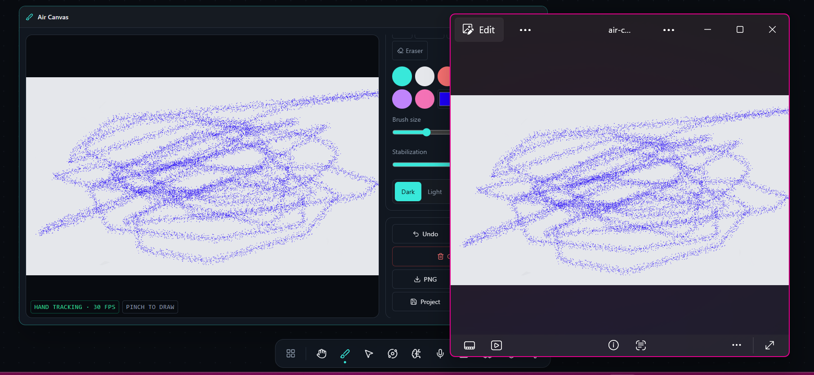</a>
</p>

<p align="center"></p>

<a id="creative"></a>
<p align="center"></p>

A Three.js particle playground with selectable visual forms and motion styles. Explore the wave and fluid fields, then switch the particle geometry between sphere, torus, and cube. The panel exposes speed, intensity, particle count, and optional interaction controls.

<br />

<p align="center">
  <strong>06A — Wave field</strong><br />
  <sub>A flowing particle surface with layered wave motion.</sub><br /><br />
  <a href="https://raw.githubusercontent.com/MUdevelops/Nothing/main/assets/wave.png">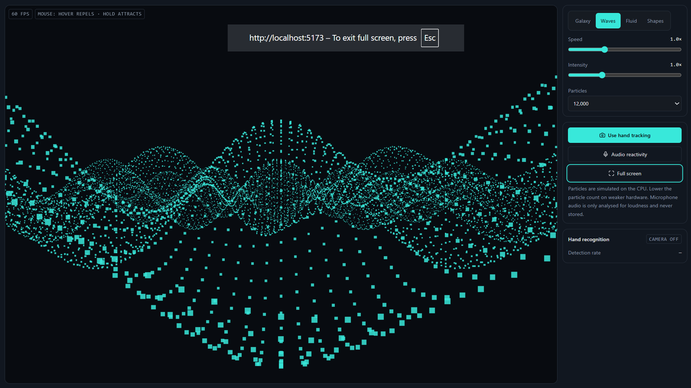</a>
</p>

<br />

<p align="center">
  <strong>06B — Fluid field</strong><br />
  <sub>A loose, fluid-like particle volume responding to interaction.</sub><br /><br />
  <a href="https://raw.githubusercontent.com/MUdevelops/Nothing/main/assets/fluid.png">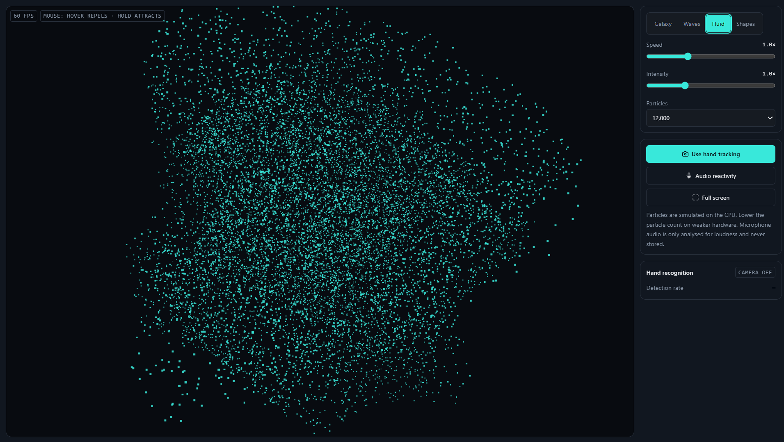</a>
</p>

<br />

<p align="center">
  <strong>06C — Sphere particles</strong><br />
  <sub>A dense spherical particle formation.</sub><br /><br />
  <a href="https://raw.githubusercontent.com/MUdevelops/Nothing/main/assets/sphere%20particle.png">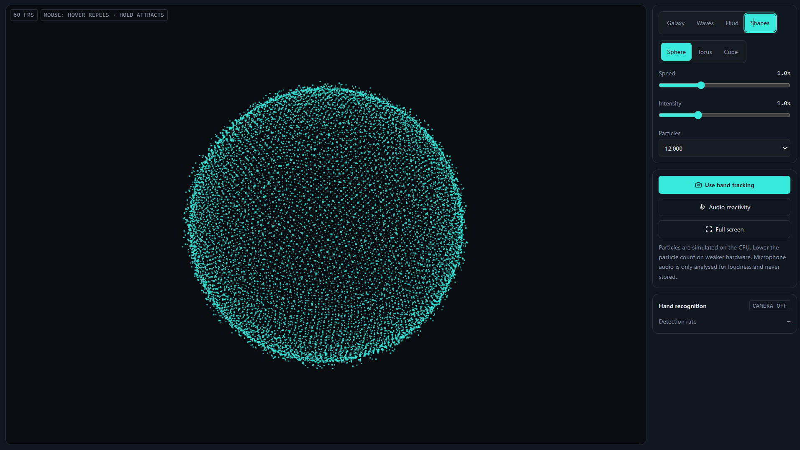</a>
</p>

<br />

<p align="center">
  <strong>06D — Torus particles</strong><br />
  <sub>A ring-shaped particle structure.</sub><br /><br />
  <a href="https://raw.githubusercontent.com/MUdevelops/Nothing/main/assets/torus%20particle.png">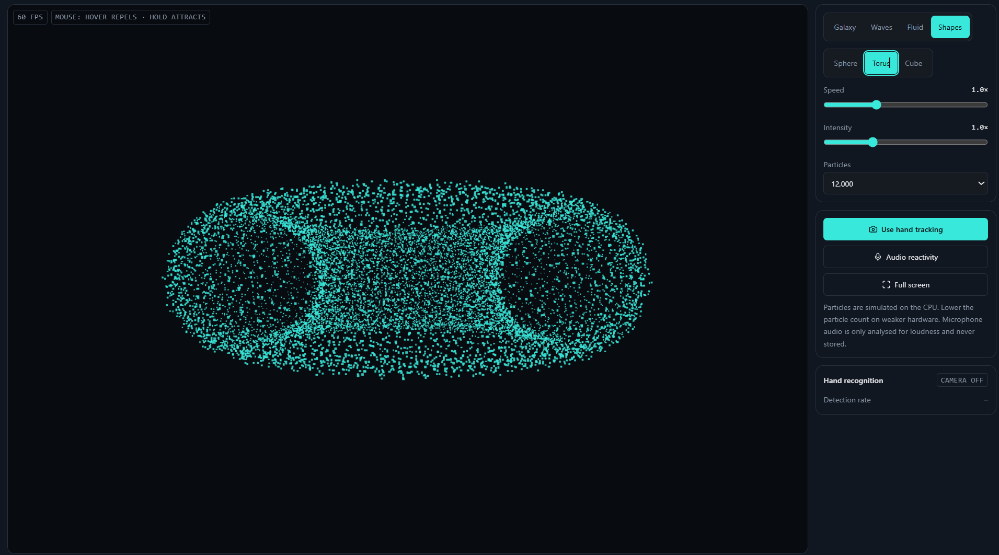</a>
</p>

<br />

<p align="center">
  <strong>06E — Cube particles</strong><br />
  <sub>A cubic particle formation with the same live creative controls.</sub><br /><br />
  <a href="https://raw.githubusercontent.com/MUdevelops/Nothing/main/assets/cube%20particles.png">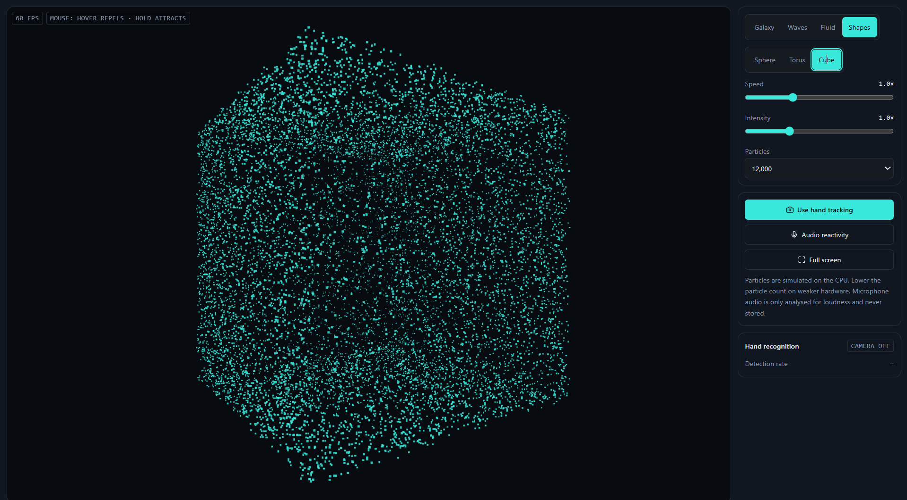</a>
</p>

<p align="center"></p>

<a id="brain"></a>
<p align="center"></p>

The Local Brain provides text tasks through locally available Transformers.js models. Voice combines local audio transcription with text-to-speech controls. Model Center is where model files can be imported, inspected, tested, and managed.

<br />

<p align="center">
  <strong>07A — Local Brain agent</strong><br />
  <sub>Generate, summarize, analyze sentiment, classify, rewrite, and answer questions with a selected local text model.</sub><br /><br />
  <a href="https://raw.githubusercontent.com/MUdevelops/Nothing/main/assets/local%20brain%20agent.png">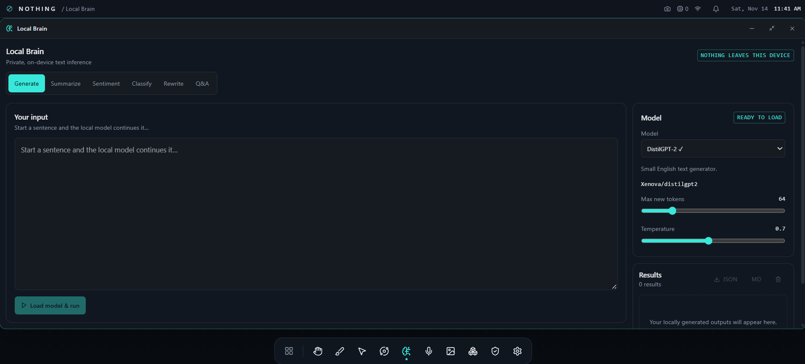</a>
</p>

<br />

<p align="center">
  <strong>07B — Voice studio</strong><br />
  <sub>Record and transcribe audio locally, inspect transcription history, and use text-to-speech controls.</sub><br /><br />
  <a href="https://raw.githubusercontent.com/MUdevelops/Nothing/main/assets/text%20to%20speech%20or%20speech%20to%20text.png">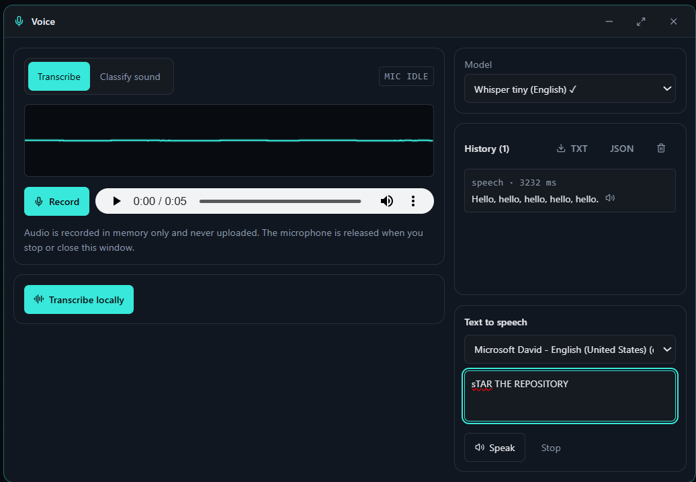</a>
</p>

<br />

<p align="center">
  <strong>07C — Model Center</strong><br />
  <sub>Import and manage supported local model assets, check their availability, and test loading.</sub><br /><br />
  <a href="https://raw.githubusercontent.com/MUdevelops/Nothing/main/assets/modelcenter.png">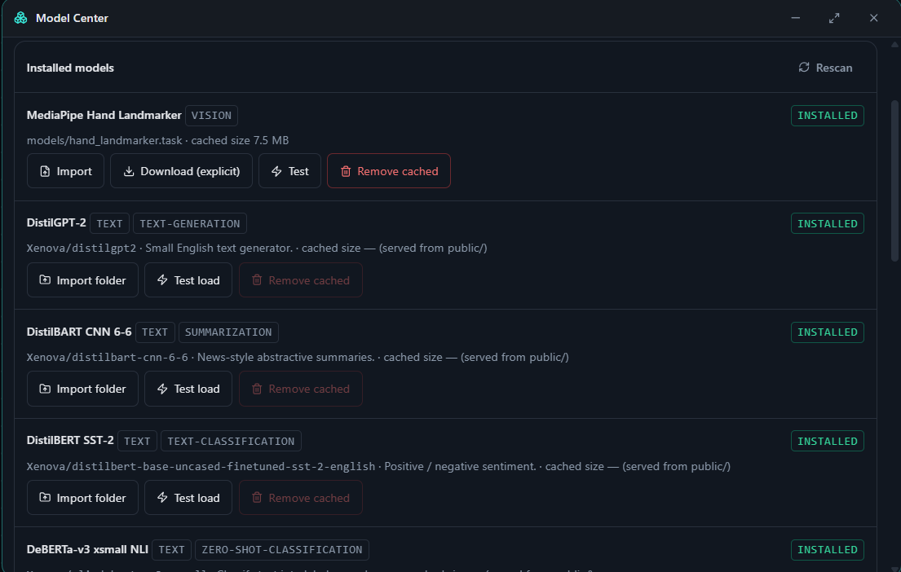</a>
</p>

<p align="center"></p>

<a id="privacy"></a>
<p align="center"></p>

The Privacy Center makes the local-processing model and browser permissions visible. Settings provide controls for appearance, devices, and performance preferences.

<br />

<p align="center">
  <strong>08A — Privacy Center</strong><br />
  <sub>Inspect permission state, inference engines, locally loaded models, and observed cross-origin requests.</sub><br /><br />
  <a href="https://raw.githubusercontent.com/MUdevelops/Nothing/main/assets/privacy.png">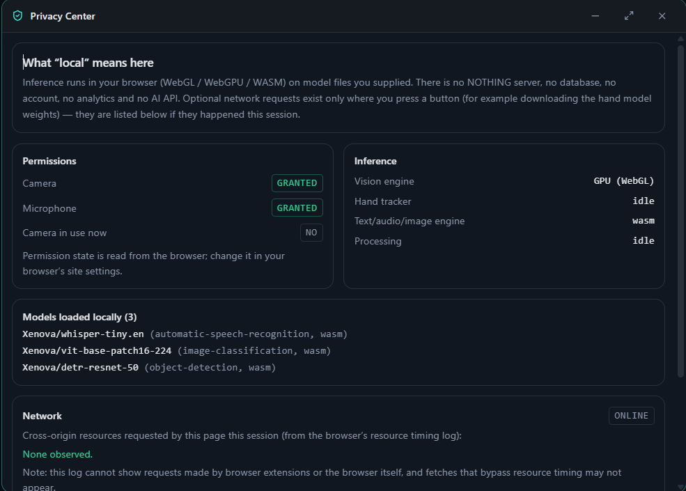</a>
</p>

<br />

<p align="center">
  <strong>08B — Settings</strong><br />
  <sub>Configure theme, accent color, camera and microphone devices, and performance preferences.</sub><br /><br />
  <a href="https://raw.githubusercontent.com/MUdevelops/Nothing/main/assets/setting.png">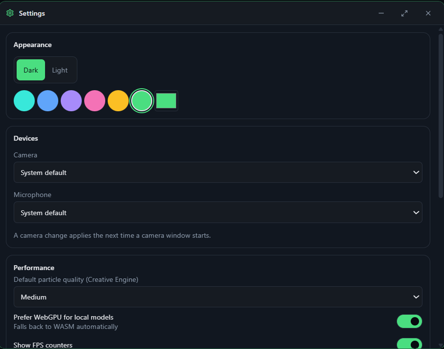</a>
</p>

<p align="center"></p>

<a id="tech"></a>
<p align="center"></p>

<p align="center"></p>

| Layer | Tools | Role |
|:--|:--|:--|
| **Application** | React 18 · TypeScript · Vite | Component-driven browser application and build tooling. |
| **Interface** | Tailwind CSS · Framer Motion · Lucide React | Styling, transitions, and interface icons. |
| **3D graphics** | Three.js | Interactive particle and visual environments. |
| **Hand tracking** | MediaPipe Tasks Vision | Hand landmarks and real-time tracking input. |
| **Local AI** | Transformers.js · ONNX Runtime Web | Browser-side model inference for supported text, audio, and image workflows. |
| **Background work** | Web Worker | Runs the Transformers.js inference worker. |
| **Persistence / offline** | Cache Storage · Service Worker · localStorage | Cache model/runtime assets and retain local preferences. |

<p align="center"></p>

<a id="run"></a>
<p align="center"></p>

### Requirements

- Node.js and npm.
- A modern browser with support for the required WebAssembly and graphics capabilities.
- Camera and/or microphone permissions for features that use those devices.
- Model files for the AI features you intend to use.

### 1. Clone the repository

```bash
git clone https://github.com/MUdevelops/Nothing.git
cd Nothing
```

### 2. Install dependencies

```bash
npm install
```

The repository's `postinstall` script copies the required MediaPipe and ONNX Runtime assets into the public runtime folders.

### 3. Start the development server

```bash
npm run dev
```

Open the local URL printed by Vite in your browser.

### 4. Check the production build

```bash
npm run typecheck
npm run build
npm run preview
```

<p align="center"></p>

<a id="models"></a>
<p align="center"></p>

NOTHING does not silently fetch model weights for inference. Make the model files available locally before opening the corresponding feature.

### Hand tracking model

Place `hand_landmarker.task` here:

```text
public/models/hand_landmarker.task
```

You can also use the in-app import/download action where available. A download is an explicit network action.

### Transformers.js models

You can place a Hugging Face model directory under:

```text
public/models/hf/<org>/<model>/
```

The model directory should contain the configuration, tokenizer assets, and supported ONNX files required by that model, for example `config.json`, tokenizer files, and `onnx/model_quantized.onnx` where applicable. You can also import a model folder through Model Center.

The Transformers.js worker is configured for local model resolution; remote model resolution is disabled.

> **Model availability matters:** a feature that depends on a model will remain unavailable until its required model files are installed or imported. Model size, browser support, and device resources affect load time and performance.

<p align="center"></p>

<a id="offline"></a>
<p align="center"></p>

<p align="center">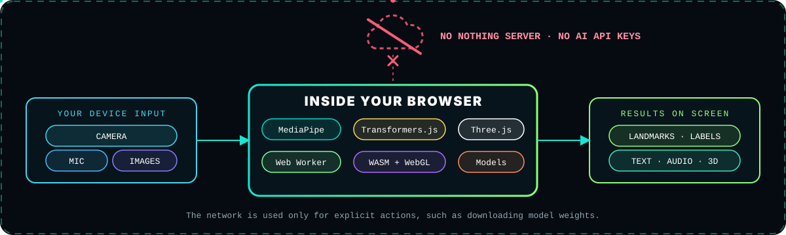</p>

- **No NOTHING inference server:** supported inference runs in the browser against local model files.
- **No AI API keys:** the project does not require a third-party AI API key.
- **No account or analytics layer:** the documented application privacy design does not include user accounts, telemetry, or analytics.
- **Device permissions stay browser-controlled:** camera and microphone access require browser permission and can be revoked in browser settings.
- **Local storage:** preferences use `localStorage`; model/runtime assets can be stored in Cache Storage.
- **Network transparency:** optional requests can occur for explicit actions such as downloading model weights. The Privacy Center reports cross-origin requests observed by the page during the session, subject to browser resource-timing visibility.
- **Offline after setup:** the service worker can cache the app shell, WASM runtimes, and installed models. First-time setup and any model download/import may require network or local file access.

<p align="center"></p>

<a id="deploy"></a>
<p align="center"></p>

### Netlify

The repository includes `netlify.toml` for Netlify deployment. Connect the repository to Netlify and use the included build configuration.

### GitHub Pages

Build with the repository path as the Vite base:

```bash
VITE_BASE=/NOTHING/ npm run build
```

Deploy the generated `dist/` directory to GitHub Pages.

### Project structure

```text
NOTHING/
├── assets/          # Product screenshots and animated README SVGs
│   └── svg/         # Self-contained animated SVG assets for this README
├── public/          # Static assets, local model paths, service worker
├── scripts/         # Build and asset-copy helpers
├── src/
│   ├── app/         # Feature registry and providers
│   ├── components/  # Desktop shell and shared UI
│   ├── features/    # Vision, canvas, gestures, AI, and other modules
│   ├── services/    # Tracking, AI client, and model storage
│   └── workers/     # Local AI worker
├── BUILD_STATUS.md  # Build status and known limitations
├── netlify.toml
├── package.json
└── vite.config.ts
```

<p align="center"></p>

<a id="status"></a>
<p align="center"></p>

The repository's current build notes report that **`npm run typecheck` and `npm run build` pass**. That confirms static validation and production compilation; it is not a claim that every device/browser workflow has passed end-to-end testing.

**Known limitations documented in the project**

- Camera, MediaPipe, Transformers.js, and Three.js behavior still needs real-browser end-to-end testing across devices.
- MediaPipe currently runs on the main thread; Transformers.js runs in a worker.
- Gesture classification is rule-based and uses the detected hand landmarks.
- No unit tests are currently included.
- AI capabilities depend on having the relevant local model files available.

See [`BUILD_STATUS.md`](BUILD_STATUS.md) for the repository's build and runtime notes.

**Roadmap**

- Move MediaPipe processing into a worker where practical.
- Explore additional vision capabilities such as segmentation.
- Expand automated and real-browser testing.
- Continue refining the visual system and icon artwork.

<p align="center"></p>

<p align="center">
  <a href="https://youtu.be/p1r9Mifmty0"></a>
  <a href="https://github.com/MUdevelops/Nothing"></a>
</p>

<p align="center"></p>

<p align="center">
  <a href="https://github.com/MUdevelops">GitHub</a> ·
  <a href="https://github.com/MUdevelops/Nothing">NOTHING Repository</a> ·
  <a href="https://youtu.be/p1r9Mifmty0">YouTube Demo</a>
</p>
